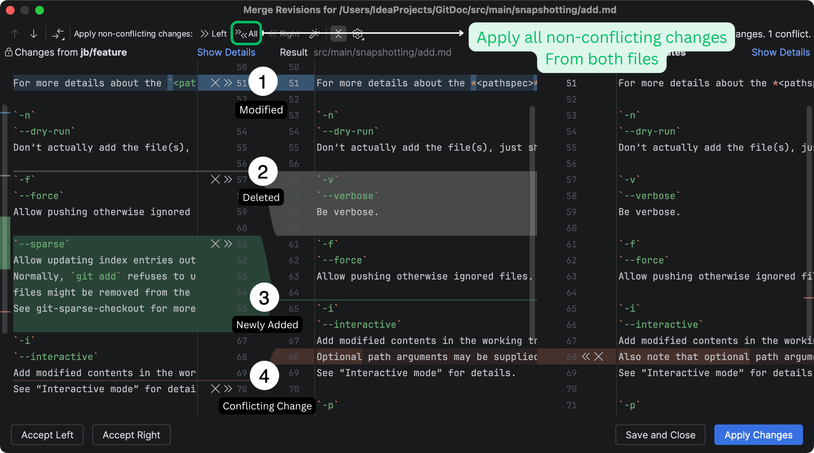

# Merging Large Files in Android Studio

I am working on a large project where teams are divided into Squads and Each Squad is responsible 
for a delivering features for specific parts of the app.

Usually when merging happens where the changes from my `local` branch and the changes from the incoming `remote` branch are equally important then I used to take each change one by one from `Left` file and `Right` file using single arrow buttons `↓ ↑`.

Whcih is kind of daunting task when it comes to common `string.xml` files or in general in any large files with alot of changes. Sometimes Android Studio hangs there as well if the project is big.

Simple solution to this is this button `>> << All`

It will take all the `Non Conflicting changes` from both the files in a resuling file and will only leave you with the changes where there is a need to resolve a conflit.

Considering all the changes in the Screenshot after pressing `>> << All` you will only be left with change # 4 only! 

Its unnoticeable but saves alot of time in such cases.

More details [here.](https://www.jetbrains.com.cn/en-us/help/idea/resolve-conflicts.html)

